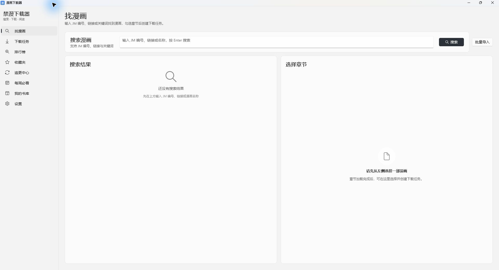

# 漫画下载器 (Comic Downloader)

面向 Windows 10/11 x64 的禁漫天堂（JMComic）下载与阅读工具，基于 C# / WinUI 3，无需单独启动后端。

[](https://github.com/Leisurely-Cloud/Comic/actions/workflows/build.yml)
[](https://github.com/Leisurely-Cloud/Comic/releases)
[](LICENSE)

**[下载最新版](https://github.com/Leisurely-Cloud/Comic/releases/latest)**



## 主要功能

- **找漫画**：JM 编号、链接或关键词搜索，排行榜、每周精选和官方收藏夹管理。
- **下载**：批量导入、断点续传、失败重试、跨重启恢复，以及并发、限速与定时下载。
- **书库**：收藏、书架与标签、阅读状态、追更补全、外部目录导入和 CBZ 导出。
- **阅读**：在线与本地阅读，直接打开或拖入 CBZ / ZIP；支持单页、双页、条漫、书签备注、缩略图和进度记忆。
- **数据维护**：设置与阅读记录备份、恢复和损坏数据检查；支持明暗主题。

## 安装

从上方链接下载安装包。运行需要：

- [.NET 9 x64 Runtime](https://dotnet.microsoft.com/download/dotnet/9.0/runtime)
- [Windows App Runtime 1.8 x64](https://learn.microsoft.com/windows/apps/windows-app-sdk/downloads-archive#windows-app-sdk-18)

安装器会检查依赖，缺少时提供官方下载入口。

## 开发

安装 [global.json](global.json) 指定的 .NET 9 SDK 后，在项目根目录执行：

```powershell
.\start-winui.cmd
dotnet test .\app\frontend-winui\src\Comic.WinUI.Tests\Comic.WinUI.Tests.csproj -c Release -r win-x64 --filter "TestCategory!=Live"
```

打包需安装 [Inno Setup 6](https://jrsoftware.org/isinfo.php)，然后运行 `.\build-installer.bat`，安装包输出到 `installer-output/`。

## 文档

[使用指南](docs/usage.md) · [更新日志](CHANGELOG.md) · [贡献指南](CONTRIBUTING.md) · [MIT 许可证](LICENSE)
