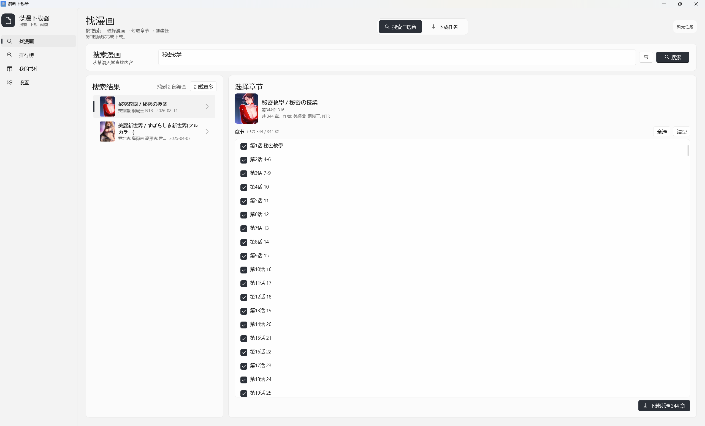

# 漫画下载器 (Comic Downloader)

面向 Windows 10/11 的 [禁漫天堂](https://18comic.vip)(JMComic)漫画下载与在线阅读工具。应用为单进程 C# 架构,集站点访问、下载调度、本地书库与阅读器于一体,无需单独启动后端服务。



[](https://github.com/Leisurely-Cloud/Comic/actions/workflows/build.yml)
[](https://github.com/Leisurely-Cloud/Comic/releases)
[](LICENSE)
[](https://dotnet.microsoft.com/download/dotnet/9.0)

## 功能特性

- **内容发现**:站内关键词搜索,支持直接输入 JM 编号或链接精确解析;排行榜(最新更新 / 最多浏览 / 最多图片 / 最多点赞)带名次与作者信息;“每周必看”直接展示 JM 官方各期精选并支持作品类型筛选。
- **下载管理**:批量下载、暂停 / 继续 / 停止,断点续传与失败章节自动重试;未完成队列跨重启保留，可选启动时继续下载；支持限速、任务并发与定时下载。图片并发数、重试次数及下载目录格式可在设置页调整,支持 `标题 [ID]/序号_章节名` 与 JM 兼容的 `本子ID/章节序号` 两种布局。
- **在线阅读**:解析漫画后无需下载即可直接翻看,分页模式支持图片预加载与进度记忆。
- **本地书库**:下载内容自动归档,支持收藏置顶、上次阅读位置提示、更新检查与 CBZ 导出；可扫描并导入外部 JM 数字目录，只补齐缺失章节且不覆盖冲突内容。
- **追更中心**:按实际章节序号检查本地漫画更新，集中展示缺失章节，支持单部或批量一键补下载。
- **官方收藏夹管理**:支持新建、重命名和删除收藏夹，收藏时选择目标文件夹，以及批量移动或取消收藏。
- **阅读器**:单页 / 条漫双模式,条漫支持滚轮缩放与自动切章;分页模式支持点击翻页、快捷键与 50%–300% 缩放;阅读进度自动保存。
- **其他**:搜索历史管理、明暗主题、文件日志(按天分文件、保留 7 天)。
- **数据维护**:备份设置、阅读进度、本地收藏和下载记录；恢复前预览并确认，重启后生效；损坏数据可从有效的上一份备份修复，缺图和未完成文件仅报告，不自动删除。

下载恢复、增量索引和数据维护自 v2.8.0 起提供；请升级安装包后使用。

## 架构

界面与核心服务运行在同一个进程中,按职责划分为独立服务,界面层通过统一的调用契约访问:

| 组件 | 说明 |
| --- | --- |
| `JmComicService` | 站点协议:搜索、解析、排行榜、每周必看、评论、章节图片解密与乱序还原 |
| `DownloadSchedulerService` | 下载任务调度:生命周期管理、断点续传、速度统计、下载历史 |
| `LibraryStorageService` | 书库存储:存储根目录、漫画元数据、章节目录枚举与路径校验 |
| `LibraryDirectoryIndex` | 进程内增量索引:按漫画缓存文件信息和条目，监听变更并局部重建 |
| `DataMaintenanceService` | 数据备份、校验预览、延迟恢复、检查修复与中断回滚 |
| `CbzExportService` | CBZ 打包导出 |
| `ReaderService` | 本地阅读访问(章节 / 图片) |

站点协议(域名、密钥、签名与图片乱序规则)集中在 `JmSiteOptions` 中,便于站点改版时快速调整。

### 技术栈

| 组件 | 技术 |
| --- | --- |
| 界面 | WinUI 3(Windows App SDK 1.8)、XAML、CommunityToolkit.Mvvm |
| 核心服务 | C#、.NET 9、HttpClient、System.Security.Cryptography、System.IO.Compression |
| 日志 | Microsoft.Extensions.Logging + 文件输出 |
| 打包 | 框架依赖发布 + Inno Setup 6 |
| CI | GitHub Actions(测试 + 安装包 + 自动 Release) |

## 环境要求

- Windows 10/11 x64
- [.NET 9 SDK](https://dotnet.microsoft.com/download/dotnet/9.0)(开发)
- [Windows App Runtime 1.8 x64](https://learn.microsoft.com/windows/apps/windows-app-sdk/downloads-archive#windows-app-sdk-18)(运行,安装包会自动检查)

## 源码运行

```bat
start-winui.cmd
```

或手动构建:

```powershell
dotnet build .\app\frontend-winui\src\Comic.WinUI\Comic.WinUI.csproj -c Debug -r win-x64
```

默认下载目录为 `%USERPROFILE%\Downloads\ComicDownloads`,可通过环境变量 `COMIC_DOWNLOAD_DIR` 自定义。

应用数据默认保存到 `%LOCALAPPDATA%\Comic.WinUI`。开发测试可设置 `COMIC_DATA_DIR` 指向独立目录，隔离配置、阅读记录、搜索历史与日志；Windows 凭据库中的账号信息不受此变量影响。

### 下载恢复与数据维护

- 未完成任务保存到当前书库的 `.comic_state/task_queue.json`，状态变更时及每 2 秒保存一次。异常退出可能丢失最后几秒的界面进度，继续时会重新核对本地已下载图片。
- “设置 → 数据与维护 → 启动时继续下载”默认关闭；开启后只自动继续此前执行或等待的任务，不改变已暂停、已停止任务。定时任务仍遵循下载计划。
- “导出备份”只备份 JSON 数据，不含漫画图片或账号凭据；请另外备份漫画文件。备份包含本地路径和阅读、搜索记录，分享前注意隐私。
- “恢复备份”要求下载目录与备份对应书库一致，且备份中的漫画目录仍存在；先预览再确认，可在重启前取消。关闭并重新打开后才应用，恢复前副本位于应用数据目录的 `backups` 子目录。
- “检查与修复”可预览损坏数据、缺失图片和 `.part` 文件。只有存在有效上一份 JSON 备份的项目可以修复，原损坏文件保留为 `.corrupt-*`；不会删除漫画或未完成文件。
- 有下载、暂停中的工作线程或定时等待任务时，导出、准备恢复/修复及切换下载目录会被拦截；请先停止并等待任务结束。恢复中断后，下次启动先回滚，文件权限异常时会保留事务记录并提示。
- 书库索引保存在内存中：每次启动的首次查询仍扫描文件，后续查询只重新扫描发生变化的漫画；它不是跨重启的持久化索引。

## 测试

```powershell
dotnet test .\app\frontend-winui\src\Comic.WinUI.Tests\Comic.WinUI.Tests.csproj -c Release -r win-x64
```

## 构建安装包

安装 .NET 9 SDK 和 [Inno Setup 6](https://jrsoftware.org/isinfo.php) 后执行:

```bat
build-installer.bat
```

输出位于 `installer-output/`。安装包为框架依赖部署,目标电脑需先安装:

- [.NET 9 x64 Runtime](https://dotnet.microsoft.com/download/dotnet/9.0/runtime)
- [Windows App Runtime 1.8 x64](https://learn.microsoft.com/windows/apps/windows-app-sdk/downloads-archive#windows-app-sdk-18)

安装器会检查上述前置条件,缺少时停止安装并给出官方下载页面。

## 发布流程

打 tag 后由 CI 自动完成测试、打包与发布:

```bash
git tag vX.Y.Z
git push origin vX.Y.Z
```

CI 会运行全部测试、从 tag 注入版本号构建安装包,并从 `CHANGELOG.md` 提取对应版本说明创建 GitHub Release。

## 项目结构

```
app/frontend-winui/
├── src/Comic.WinUI/           # WinUI 3 桌面应用
│   ├── Services/Native/       # 职责化核心服务(站点/下载/书库/导出/阅读)
│   ├── Services/Logging/      # 文件日志
│   ├── ViewModels/            # MVVM 视图模型
│   ├── Views/                 # 页面
│   └── Controls/              # 复用控件
└── src/Comic.WinUI.Tests/     # 协议、模型与应用服务测试
```

## 贡献

欢迎提交 Issue 与 Pull Request,请参阅 [CONTRIBUTING.md](./CONTRIBUTING.md)。

## 许可证

[MIT](./LICENSE)
